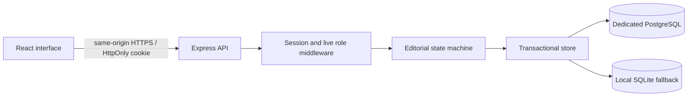

# Architecture

`backend/domain.js` owns transitions and validates role, author identity, revision, version, and state. `backend/middleware/rbacMiddleware.js` verifies JWTs and resolves live sessions and users. `backend/app.js` exposes authentication, private editorial endpoints, administration, and a deliberately limited public-wire projection. `frontend/src/components/RoleGuard.jsx` controls presentation. Server checks remain authoritative.

Hosted state lives in `signalroom_state`, a single PostgreSQL JSONB row protected with `SELECT FOR UPDATE`. SQLite uses a transaction and a serialized mutation queue locally. The model keeps multi-step transitions atomic and is suitable for a bounded demonstration. It trades write concurrency for simplicity; normalize entities before scaling. Public responses exclude internal notes, private revisions, password hashes, and sessions.

The frontend is built by Vite and served by Express from `dist/`. Fonts and graphic artwork are local. No external image API or generated image dependency is needed. Health checks query the database. SIGTERM closes the HTTP server and database connection gracefully.

## Operational notes

- Store database and signing secrets only in private environment variables.
- Use provider TLS and a dedicated database; never use an ephemeral filesystem for hosted storage.
- Keep regular external backups. A non-expiring branch is not a backup guarantee.
- Demo tenants expire after 24 hours and are removed lazily on demo requests.
- Rate limiting is per process. Multi-instance hosting needs a shared limiter and careful trusted-proxy configuration.
- Password recovery and email delivery require a separate implementation before wider public use.
